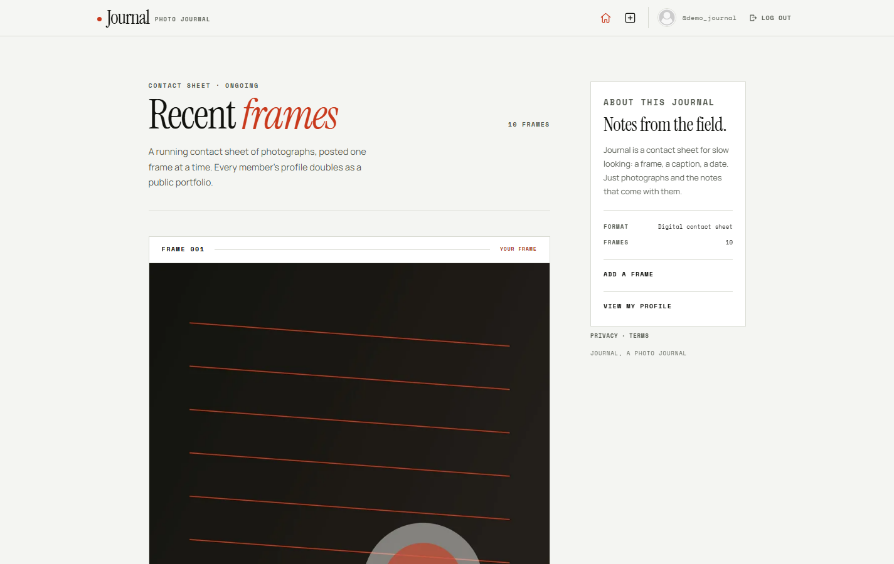

# Journal

A photo journal with a public portfolio side: dated frames, captions, comments, follows, and a clean `/u/:username` page that works as a mini portfolio.

**Live app:** https://insta-clone.furqankhan.dev
**API:** https://insta-clone-backend-n518.onrender.com

**Demo account:** `demo_journal` / `DemoJournal2026!` (shared; the feed also contains older test frames)




## What it is

Journal is a calm alternative to a noisy social feed. Members keep a dated contact sheet of photographs; each profile is also a public portfolio that can be shared with anyone, signed in or not.

The interface stays a printed contact sheet: frame numbers, date stamps, white photo cards, serif masthead, and a desktop journal rail.

## Product capabilities

**Journal feed**
- Cursor-paginated feed (`10` posts per page) sorted newest first.
- One aggregation pipeline builds author, like count, comment count, and viewer like state per frame.
- Initial skeletons, a signed-out state, empty state, error retry, and a "Load more frames" action.
- Like/unlike with `aria-pressed`, an optimistic-feeling pop, exact counts, and inline errors.
- Optional date stamps. Legacy posts without `createdAt` still render (no date is shown).

**Comments**
- Expandable thread on every frame with the comment count visible in the footer.
- Composer with a 500-character limit, optimistic add, inline errors, and retry-safe state.
- Delete for your own comments with a two-step confirmation.
- "Load earlier notes" cursor pagination.

**Profiles and follow**
- Public `/u/:username` portfolio: avatar, bio, frames, followers, following, and follow state.
- Grid of frames that opens the original photograph.
- Follow/unfollow wired to the API with instant follower-count updates.
- Owner can edit their bio (160 characters) and copy the public profile link.
- Navbar avatar links to the signed-in member's own profile.
- Public profiles work for signed-out visitors; the feed remains members-only.

**Publishing and image pipeline**
- Protected `/create-post` route with local preview, caption, and inline errors.
- Browser-side resize to 1600 px and JPEG compression (~0.82 quality) before upload.
- Server accepts JPEG, PNG, and WebP only, up to 5 MB, using memory storage and MIME + file-signature checks.
- The original ImageKit URL is stored. Feed and profile thumbnails use an 800 px / quality 80 ImageKit transformation URL.
- Owners can delete their own frames; likes and comments are removed with the post.

**Security baseline**
- `helmet` security headers.
- `express-rate-limit`: 10 requests/minute per IP on auth routes, 30/minute on posts and comments.
- JWT in an `httpOnly`, `SameSite=Lax`, `Secure` cookie in production; bcrypt password hashing.
- Comment and bio length validation on both client and server.
- CORS remains restricted to the production app and local development origins.
- `trust proxy` is set for Render/Vercel deployments.

**Public pages and discovery**
- `/privacy` and `/terms` describe what Journal stores, the processors it relies on, deletion requests, and the rules for the beta service.
- Both pages are linked from the login page, the feed rail, and every public profile.
- `robots.txt`, `sitemap.xml`, a canonical URL and an Open Graph URL cover search and sharing basics.
- Vercel Analytics runs in the app root and needs no environment variables.

## Tech stack

| Layer | Choice |
|---|---|
| Frontend | React 19, Vite, react-router-dom, Sass design tokens, Vercel Analytics |
| Backend | Node.js, Express 5, Mongoose, JWT, bcrypt, multer, ImageKit, helmet, express-rate-limit |
| Hosting | Vercel (web), Render (API), MongoDB Atlas (database) |

## Project structure

```
backend/
  server.js
  src/app.js                  Express app, CORS, security middleware
  routes/                     auth, posts (incl. comments), users
  controllers/                auth, posts, comments, users
  models/                     User, Post, Like, Follow, Comment
  middleware/                 JWT auth, rate limits, error handling
  utils/                      feed aggregation, cursor, ImageKit transforms
frontend/
  src/
    app.routes.jsx            Router + layout
    features/auth/            session hydration, login, register
    features/posts/           feed, post card, comments, create page, context
    features/users/           public profile page
    features/legal/           privacy and terms pages
    features/shared/          navbar, avatar, API clients, image compression
```

## Run locally

```bash
# API
cd backend
npm install
cp .env.example .env         # Mongo, JWT and ImageKit keys
npm start                    # http://localhost:3006

# Web
cd frontend
npm install
npm run dev                  # http://localhost:5173
```

The frontend talks to the deployed API by default. To use a local API, create `frontend/.env.local`:

```bash
VITE_API_URL=http://localhost:3006
```

No new environment variables are required for the MVP.

### Environment variables

| Key | Required | Purpose |
|---|---|---|
| `PORT` | No | API port (defaults to `3006`) |
| `MONGO_URI` | Yes | MongoDB connection string |
| `JWT_SECRET` | Yes | Signs auth cookies |
| `IMAGEKIT_PRIVATE_KEY` | Yes | Server-side ImageKit uploads |
| `VITE_API_URL` | No | Frontend API origin; defaults to the deployed API |

## API

All routes are prefixed with `/api`. Feed, post, comment and follow routes require the auth cookie; profile reads are public.

| Method | Route | Auth | Purpose |
|---|---|---|---|
| `POST` | `/auth/register` | Public | Create account |
| `POST` | `/auth/login` | Public | Sign in, set cookie |
| `GET` | `/auth/get-me` | Cookie | Current user |
| `POST` | `/auth/logout` | Cookie | Clear the auth cookie |
| `GET` | `/posts/feed?cursor=&limit=10` | Cookie | Cursor-paginated feed |
| `POST` | `/posts` | Cookie | Upload a post (`multipart`, field `image`) |
| `DELETE` | `/posts/:postId` | Cookie | Delete own frame |
| `POST` | `/posts/like/:postId` | Cookie | Like (idempotent) |
| `POST` | `/posts/unlike/:postId` | Cookie | Unlike (idempotent) |
| `GET` | `/posts/:postId/comments?cursor=&limit=20` | Cookie | Comment thread |
| `POST` | `/posts/:postId/comments` | Cookie | Add comment (`{ text }`) |
| `DELETE` | `/posts/:postId/comments/:commentId` | Cookie | Delete own comment |
| `GET` | `/users/:username?cursor=&limit=12` | Public | Public profile + paginated frames |
| `PATCH` | `/users/me` | Cookie | Update `bio` and/or `profile_image` URL |
| `POST` | `/users/follow/:username` | Cookie | Follow |
| `POST` | `/users/unfollow/:username` | Cookie | Unfollow |

Pagination responses include `nextCursor`; pass it back as `cursor` for the next page. A `null` cursor means the end of the roll.

## Data model notes

- `Post`, `User`, and `Follow` use Mongoose timestamps. Existing documents without `createdAt` are still returned; they simply sort after dated posts and render without a date stamp.
- `Post` keeps `likesCount` and `commentsCount` counters, while feed/profile reads compute counts with `$lookup` so older posts are accurate too.
- `Comment` stores `post`, `user` (username), `text` (max 500), and timestamps.
- Deleting a frame removes its database record, likes, and comments. The ImageKit original is left in place.

## Deployment notes

- The API runs on Render's free plan, so the first request after idle can take ~50 seconds.
- CORS is restricted to the production app URL plus localhost.
- Uploads require a valid ImageKit private key on the API.
- `frontend/vercel.json` rewrites client routes to `index.html`.
- Auth cookies are `Secure`; local development should use the deployed API or serve the local API over HTTPS if you need cookie auth.

## Verification

```bash
# Backend syntax
find . -name "*.js" -not -path "./node_modules/*" -exec node --check {} \;

# Frontend
cd frontend
npm run lint
npm run build
```
