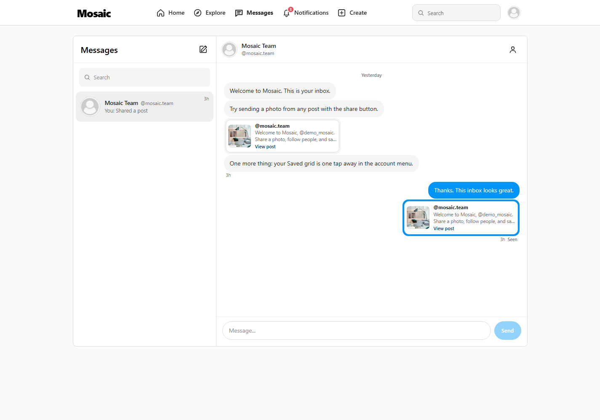

# PhotoSocial

> A complete social loop for photos, stories and messages.

[](https://photosocial.furqankhan.dev)
[](https://furqankhan.dev)
[](LICENSE)

PhotoSocial is a photo-sharing app built around the whole social loop, not a single feed screen: photos, 24-hour stories, threaded comments, direct messages, notifications, search, saved posts and public profiles. It is for anyone who wants to see how those pieces behave together in one product. Part of [Furqan Khan's portfolio](https://furqankhan.dev).

**Live:** https://photosocial.furqankhan.dev · **Source:** https://github.com/fk219/photo-social · **Case study:** https://furqankhan.dev




## What it is

A visitor can browse Explore and open a shared post without an account. A signed-in member gets a Following feed, can publish photos and stories, follow people, reply in comment threads, message another member, share a post into a conversation, save posts privately, and receive notifications for the activity that involves them.

The product is deliberately complete rather than a mockup of one flow. Every action writes to the same post, user and conversation records, so a photo can be liked, discussed, saved, sent in a DM, reported or deleted without leaving the loop.

## The signature idea

The signature is the loop itself, plus the read paths that keep it usable. Feeds are cursor-paginated on a `(createdAt, _id)` boundary. Guest Explore reads are served through a small stale-while-revalidate cache. Stories expire through a MongoDB TTL index. Comments allow exactly one reply level. Direct messages poll only while the tab is visible, using an incremental `after` cursor for the open conversation.

That combination means the social surface stays consistent: the same post object powers the feed card, the post modal, the saved grid, the share sheet and the shared link at `/p/:postId`.

## What works

**Feed and stories**

- A Following feed with the viewer's own posts plus posts from accounts they follow. Guests are redirected to Explore.
- A public Explore grid for signed-in and signed-out visitors, with Following and Explore tabs above a centered feed column.
- A story rail with your own story, followed accounts, unseen rings and a full-screen viewer.
- Stories advance every 5 seconds, pause while the pointer is down or the tab is hidden, support arrow-key navigation and Escape to close, and expire after 24 hours.
- Cursor pagination, per-tab page state and a warmed guest feed cache.

**Posts**

- Instagram-style cards with author, image, like, comment, share and save actions, like count, caption, recent comments and relative time.
- Double-click or double-tap the photo to like it, with a heart burst animation.
- Likes update optimistically and reconcile with the server count. The count opens the real list of people who liked the post.
- A private Saved grid.
- Sharing by copying the post link, using the device share sheet, or sending the post in a direct message.
- Owners can delete their own posts. The post, its likes, comments, comment likes, saves and related notifications are removed together. The ImageKit original is not deleted.
- Post detail at `/p/:postId`, so shared links open the full post.
- Captions render `@mentions` and `#hashtags` as links.

**Comments**

- Top-level comments with one level of replies.
- Comment likes with optimistic updates.
- Reply composer with visible "Replying to" context and a cancel action.
- Load earlier comments and load all replies.
- Authors can delete their own comments or replies; deleting a parent removes its replies.
- Mentions in comments create notifications.

**Direct messages**

- Two-pane inbox and chat on desktop, single-pane on mobile.
- Conversation list with search, display names, last message, relative time and unread counts.
- Day dividers, shared post cards, seen state and an accessible composer.
- Enter sends; Shift+Enter adds a line.
- Inbox polling every 20 seconds and open-chat polling every 5 seconds, both skipped while the tab is hidden. The chat poll is incremental with `after`.
- Start a conversation from a profile, the inbox or the share sheet.
- Unread message badge in the navigation.

**Notifications**

- Like, comment, reply, follow and mention notifications.
- Grouped by Today, This week and Earlier.
- Unread state, mark one or mark all as read, and an unread badge in the navigation.
- Clicking a notification opens the related post, comment context or profile.
- No notifications for your own activity.

**Search, profiles and settings**

- Search people by username or name, posts by caption, and hashtags, with All, People, Posts and Tags tabs.
- Debounced queries with stale-response protection, recent searches in local storage and trending tags from the last 30 days of captions.
- Suggested accounts, followers and following lists, profile grid and shared post modal.
- Edit name, bio and avatar; block and report accounts; report posts and comments.
- Account settings with password change, JSON export, blocked-account management and account deletion.
- The shared demo account is protected from password changes and deletion.

**Hardening**

- `helmet` headers, compression and a 1 MB JSON body limit.
- Per-IP limits: auth 10/min, account changes 5/min, post routes 30/min, social routes 60/min, avatar and story uploads 10/min.
- A one-day JWT in an `httpOnly`, `SameSite=Lax` cookie, `Secure` in production, with bcryptjs password hashing.
- Session JWTs carry a `tokenVersion`; a password change increments it and invalidates older tokens. Logout adds the token to a blacklist with a 24-hour TTL.
- CORS restricted to an allowlist, plus an origin check on non-GET requests.
- Uploads are MIME-checked and signature-checked, capped at 5 MB, and stored in ImageKit.

## Tech stack in detail

| Layer | Technology | What it does here |
|---|---|---|
| Web client | React 19, Vite 6, React Router 7 | SPA routes for feeds, post detail, profiles, messages, notifications and settings |
| Styling | Sass with shared design tokens | Light social surface, three-column grids, compact mobile navigation |
| API | Node.js 22, Express 5 | REST API under `/api`, plus `/` and `/health` |
| Database | MongoDB, Mongoose 8 | Users, posts, comments, stories, conversations, messages, notifications, blocks and reports |
| Auth | `jsonwebtoken`, `bcryptjs` | Cookie sessions, hashed passwords, token versioning, logout blacklist |
| Media | `multer`, `@imagekit/nodejs` | In-memory uploads, image validation, ImageKit storage and feed thumbnails |
| Read path | Cursor pagination, batched queries, SWR cache | Stable pages and fewer database round trips per feed read |
| Hardening | `helmet`, `express-rate-limit`, CORS allowlist | Security headers, per-IP limits, origin checks |
| Hosting | Vercel, Render, MongoDB Atlas | Static web app, API service and managed database |
| Analytics | `@vercel/analytics` | Page analytics on the web app |

## Architecture

The browser loads the React SPA from Vercel. In production, `frontend/vercel.json` rewrites `/api/*` to the Render API and sends every other path to `index.html`, so client routes work on refresh. The API applies CORS, cookie parsing, authentication, rate limits and validation before a controller touches MongoDB.

Feed reads use `fetchPostsPage`, which batches posts, authors, viewer likes, viewer saves, viewer follows and recent comments into a small number of queries. Public guest Explore pages can be served from an in-memory cache for 60 seconds fresh and up to 10 minutes stale while a refresh runs. Writes update denormalized counters and create notification records; media uploads go to ImageKit while MongoDB keeps the returned URL.

```
Browser (React 19)
  |  GET /api/posts/feed, /api/stories/feed, /api/messages/...
  v
Vercel (SPA + /api rewrite)
  |
  v
Express API (Render)
  |-- helmet, CORS, cookie auth, rate limits
  |-- controllers -> models -> MongoDB Atlas
  |-- multer -> validation -> ImageKit
  `-- /health -> API + database state
```

```
backend/
  server.js
  src/app.js                     Express app, CORS, security middleware
  config/database.js             Mongoose connection
  routes/                        auth, post, user, message, notification, search, story
  controllers/                   auth, post, comment, user, message, notification, search, story
  models/                        User, Post, Comment, CommentLike, Like, Follow, Save, Story,
                                 Conversation, Message, Notification, Block, Report, Blacklist
  middleware/                    auth, error handling, rate limits
  utils/                         cursor, feed cache, feed queries, ImageKit, mentions, uploads
  test/api.test.js
frontend/
  src/app.routes.jsx             Router and app shell
  src/features/
    auth/ posts/ messages/ notifications/ search/ saved/ stories/
    users/ settings/ social/ legal/ shared/
docs/
  preview.png messages.png profile.png
frontend/vercel.json             SPA fallback and /api proxy
.github/workflows/ci.yml         API tests, syntax check, web lint and build
```

## Run it locally

Prerequisites: Node.js 22 (see `.nvmrc`), npm, a MongoDB connection string and an ImageKit private key. The API tests use an in-memory MongoDB, so they do not need Atlas.

```bash
# API
cd backend
npm install
cp .env.example .env         # fill MONGO_URI, JWT_SECRET and IMAGEKIT_PRIVATE_KEY
npm run dev                  # http://localhost:3006

# Web
cd ../frontend
npm install
npm run dev                  # http://localhost:5173
```

The Vite dev server proxies `/api` to the deployed Render API by default. To use the local API instead, create `frontend/.env.local`:

```bash
VITE_API_URL=http://localhost:3006
```

On PowerShell, use `Copy-Item .env.example .env` in place of `cp`.

### Environment variables

| Name | Required | Purpose |
|---|---|---|
| `PORT` | No | API port; defaults to `3006` |
| `NODE_ENV` | No | Set to `production` to mark auth cookies `Secure` |
| `MONGO_URI` | Yes | MongoDB connection string |
| `JWT_SECRET` | Yes | Signs auth cookies |
| `IMAGEKIT_PRIVATE_KEY` | Yes | Server-side ImageKit uploads |
| `CORS_ORIGINS` | No | Comma-separated allowed origins; defaults to localhost and the production app |
| `VITE_API_URL` | No | Frontend API origin for local development; production uses the `/api` rewrite |

### Demo access

The sign-in page can fill the shared demo account: `demo_photo` / `DemoPhotoSocial2026!`. It is shared by every visitor, so do not post private information with it. The account cannot change its password or delete itself.

## API

`GET /health` reports API and database readiness. Product routes are prefixed with `/api`. Feed, post detail, profile, comment, like-list, search and story-read routes also work for signed-out visitors; social actions and account routes need the auth cookie.

### Auth and account

| Method | Path | Purpose |
|---|---|---|
| `POST` | `/api/auth/register` | Create an account and set the cookie |
| `POST` | `/api/auth/login` | Sign in with username or email |
| `GET` | `/api/auth/get-me` | Current user |
| `POST` | `/api/auth/logout` | Clear the cookie and blacklist the token |
| `PATCH` | `/api/auth/password` | Change password and sign out all sessions |
| `GET` | `/api/auth/export` | Download account, social and media records as JSON |
| `DELETE` | `/api/auth/account` | Delete the account and related records |

### Posts, comments and saves

| Method | Path | Purpose |
|---|---|---|
| `GET` | `/api/posts/feed?scope=all&cursor=&limit=10` | Public Explore feed |
| `GET` | `/api/posts/feed?scope=following` | Following feed (cookie required) |
| `GET` | `/api/posts/saved` | Current user's saved posts |
| `GET` | `/api/posts` | Current user's own posts |
| `POST` | `/api/posts` | Create a post (`multipart`, field `image`) |
| `GET` | `/api/posts/:postId` | Full post detail |
| `POST` | `/api/posts/details/:postId` | Owner-only post detail |
| `DELETE` | `/api/posts/:postId` | Delete an own post |
| `POST` | `/api/posts/:postId/save` | Save a post |
| `DELETE` | `/api/posts/:postId/save` | Remove a saved post |
| `GET` | `/api/posts/:postId/likes` | People who liked the post |
| `POST` | `/api/posts/like/:postId` | Like a post |
| `POST` | `/api/posts/unlike/:postId` | Unlike a post |
| `GET` | `/api/posts/:postId/comments` | Top-level comments with reply previews |
| `POST` | `/api/posts/:postId/comments` | Add a comment or reply (`parentId` optional) |
| `DELETE` | `/api/posts/:postId/comments/:commentId` | Delete an own comment or reply |
| `GET` | `/api/posts/:postId/comments/:commentId/replies` | Paginated replies |
| `POST` | `/api/posts/:postId/comments/:commentId/like` | Like a comment |
| `DELETE` | `/api/posts/:postId/comments/:commentId/like` | Unlike a comment |

### Messages and notifications

| Method | Path | Purpose |
|---|---|---|
| `GET` | `/api/messages/conversations` | Conversation list with unread counts |
| `POST` | `/api/messages/conversations` | Get or start a conversation by `username` |
| `GET` | `/api/messages/conversations/:id` | Messages; supports `after` polling |
| `POST` | `/api/messages/conversations/:id/messages` | Send text or a shared post |
| `POST` | `/api/messages/conversations/:id/read` | Mark the conversation read |
| `GET` | `/api/messages/unread-count` | Unread message badge count |
| `GET` | `/api/notifications` | Paginated notifications |
| `POST` | `/api/notifications/read-all` | Mark every notification read |
| `POST` | `/api/notifications/:id/read` | Mark one notification read |
| `GET` | `/api/notifications/unread-count` | Unread notification badge count |

### Users, follows, blocks and reports

| Method | Path | Purpose |
|---|---|---|
| `GET` | `/api/users/suggested` | Suggested accounts |
| `GET` | `/api/users/blocked` | Blocked accounts |
| `PATCH` | `/api/users/me` | Update name, bio or profile image URL |
| `POST` | `/api/users/me/avatar` | Upload an avatar (`multipart`, field `image`) |
| `GET` | `/api/users/:username` | Profile and paginated posts |
| `GET` | `/api/users/:username/followers` | Followers |
| `GET` | `/api/users/:username/following` | Following |
| `POST` | `/api/users/follow/:username` | Follow an account |
| `POST` | `/api/users/unfollow/:username` | Unfollow an account |
| `POST` | `/api/users/:username/block` | Block an account |
| `DELETE` | `/api/users/:username/block` | Unblock an account |
| `POST` | `/api/users/:username/report` | Report an account |

### Search and stories

| Method | Path | Purpose |
|---|---|---|
| `GET` | `/api/search?q=&type=all` | People, posts and tags; `type` is `all`, `users`, `posts` or `tags` |
| `GET` | `/api/search/trending` | Trending hashtags from recent captions |
| `GET` | `/api/stories/feed` | Story groups for the rail |
| `POST` | `/api/stories` | Upload a story (`multipart`, field `image`) |
| `GET` | `/api/stories/:username` | One account's active stories |
| `POST` | `/api/stories/:id/seen` | Mark a story seen |
| `DELETE` | `/api/stories/:id` | Delete an own story |

Paginated responses include `nextCursor`; pass it back as `cursor`. A `null` cursor means the end of the view.

## Tests

```bash
cd backend
npm test                     # 7 API tests against an in-memory MongoDB

cd ../frontend
npm run build                # production build
npm run lint                 # currently reports two no-empty errors in src/theme.js
```

The API suite covers health, the guest Explore feed, auth guards, registration validation and duplicate handling, login, public profiles, post-write authorization and public search. The web build passes. The lint script is configured with ESLint and flags the empty `catch {}` blocks in `src/theme.js`; fix those before expecting the CI web job to pass.

## Deployment

- The web app is on Vercel. `frontend/vercel.json` rewrites `/api/:path*` to `https://photo-social-api.onrender.com/api/:path*` and all other paths to `index.html`.
- The API is on Render's free plan. The first request after idle can take around 50 seconds.
- MongoDB Atlas provides the database through `MONGO_URI`; ImageKit provides media storage and thumbnails.
- Auth cookies are `Secure` in production. Local development should use the deployed API or serve the local API over HTTPS if cookie auth is needed.
- GitHub Actions runs the API suite, a syntax check, and the web install, lint and build on pushes to `main` and pull requests.

## Limits and notes

- The demo account is shared, so its posts, messages and likes are visible to other visitors. It cannot be deleted or have its password changed.
- There is no email verification or password-reset flow.
- Direct messages use polling, not WebSockets. The chat poll runs only while the page is visible.
- Guest Explore pages can be up to 60 seconds old, with a stale copy served for up to 10 minutes while a refresh runs.
- Rate limits use express-rate-limit's in-memory store. They reset when the API restarts and are not shared across instances.
- Deleting a post or account removes database records, but ImageKit originals remain at their URLs.
- The API runs on a free Render instance, so cold starts can be slow.

## License

MIT. See [LICENSE](LICENSE).
